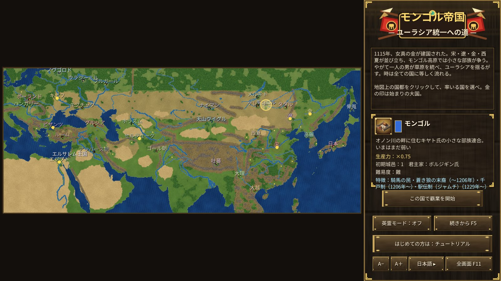

# モンゴル帝国 — ユーラシア統一への道

1115年、女真の金が建国された。宋・遼・金・西夏が並び立ち、モンゴル高原では小さな部族が争う。
やがて一人の男が草原を統べ、ユーラシアを揺るがす——。

本作は、1115〜1294年のユーラシア大陸を舞台にしたリアルタイムストラテジーです。日本・高麗・宋・金・西夏・ナイマン・ケレイト・骨嵬・ホラズム・エジプト・ビザンツ・キエフ・ポーランド・ハンガリーなど34か国から一国を選び、1294年までにユーラシアの統一を目指します。

## 遊び方の要点

- **資源**：糧（田）・木（森）・鉄（鉱山）。民が集め、都・邑へ運ぶ。
- **国ごとの兵種**：作れる兵は国によって違う。兵営のボタンにマウスを重ねると強さが分かる。騎射兵は騎兵でありながら遠くから射る。
- **服属**：他国が築いた城邑を攻め落とすと、その国の兵も作れる（ボタンに＊）。
- **船**：海を渡るには船が要る。船を造れるのは日本・高麗・宋・南宋だけ（それらの城邑を領すれば他国も造れる）。民で海辺に「港」を建て、港で船を造る。兵を選んで岸辺の船を右クリックで乗船（6人まで）、船を選んで陸を右クリックで上陸。
- **邑の破壊**：自国の邑を選び「邑を焼き払う」で戦利品を得る。
- **国の盛衰**：宋は初め世界一の強国だが、靖康の変（1127年）で南宋となり、やがて追い詰められる。モンゴルは初め弱いが、テムジンの登場（1189年）・草原の諸部族の服属・チンギス・カンの即位（1206年）で強くなる。
- **英霊召喚**：自国領内の民を生贄に、自分の文明・民族に属する英雄の英霊を呼べる。すべての対局で使える。
- **テングリの降臨**：1294年までに統一できなければ、永遠の蒼き天がモンゴルに降臨する。

操作はゲーム内のヘルプ（F1）とチュートリアル（モンゴルで開始）を参照。

## Windows 版

同じゲームを Windows のアプリとしても遊べます（Direct3D11 / Direct2D で描画）。`cargo run --release --bin yymongolia-win` で起動するか、GitHub Actions の成果物 `yymongolia-windows` の `yymongolia-win.exe` を実行します。記録は `%APPDATA%\yymongolia\saves` に保存され、ブラウザ版と同じ形式なので書き出して持ち運べます。
