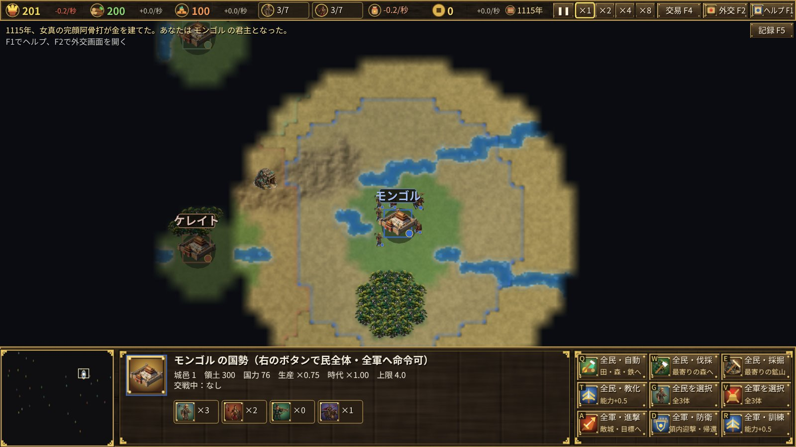

# 蒙古帝国 — 欧亚一统之路

1115年，女真建立金国。宋、辽、金、西夏并立，蒙古高原上小部落彼此争斗。不久，一个人将统一草原、震撼欧亚。

本作是以1115〜1294年欧亚大陆为舞台的即时战略游戏。从日本、高丽、宋、金、西夏、乃蛮、克烈、骨嵬、花剌子模、埃及、拜占庭、基辅、波兰、匈牙利等34国中选择一国，在1294年之前统一欧亚。

## 要点

- **资源**：粮（田）、木（森林）、铁（矿山）。
- **各国兵种**：各国可训练的兵种不同；骑射兵虽是骑兵却能远射。
- **臣属**：攻下他国所筑城邑后，也可训练该国兵种（带＊）。
- **船**：只有日本、高丽、宋、南宋能造船（占有其城邑者亦可）。在海边建港口造船，士兵右键点船登船（每船6人），船右键点陆地登陆。
- **焚毁城邑**：焚毁己方的邑可获战利品。
- **国家盛衰**：宋起初最富强，靖康之变（1127年）后成为南宋；蒙古起初弱小，随铁木真崛起（1189年）、草原诸部臣服、成吉思汗即位（1206年）而强大。
- **英灵模式**：可召唤成吉思汗、北条时宗、拜巴尔斯、岳飞等真实将领与帝王的英灵。
- **腾格里降临**：若1294年前未能统一，长生天将降临于蒙古。

操作请参阅游戏内帮助（F1）与教程（以蒙古开始）。

## Windows 版

同一款游戏也可作为 Windows 应用运行（以 Direct3D11 / Direct2D 绘制）。用 `cargo run --release --bin yymongolia-win` 启动，或运行 GitHub Actions 产物 `yymongolia-windows` 中的 `yymongolia-win.exe`。存档保存在 `%APPDATA%\yymongolia\saves`，与网页版格式相同，导出后可互相使用。
